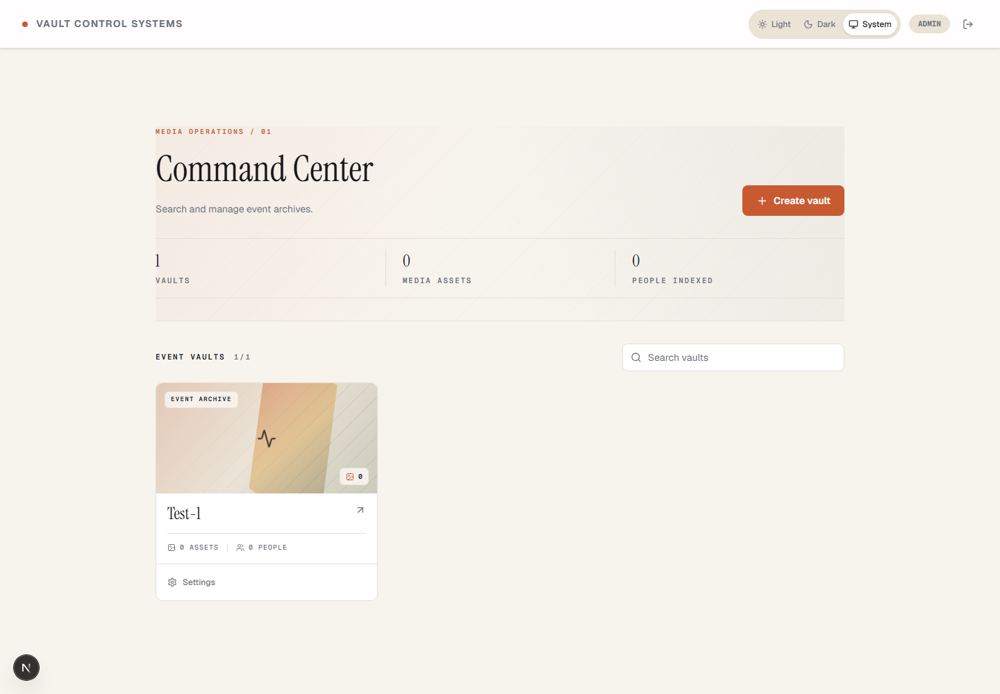
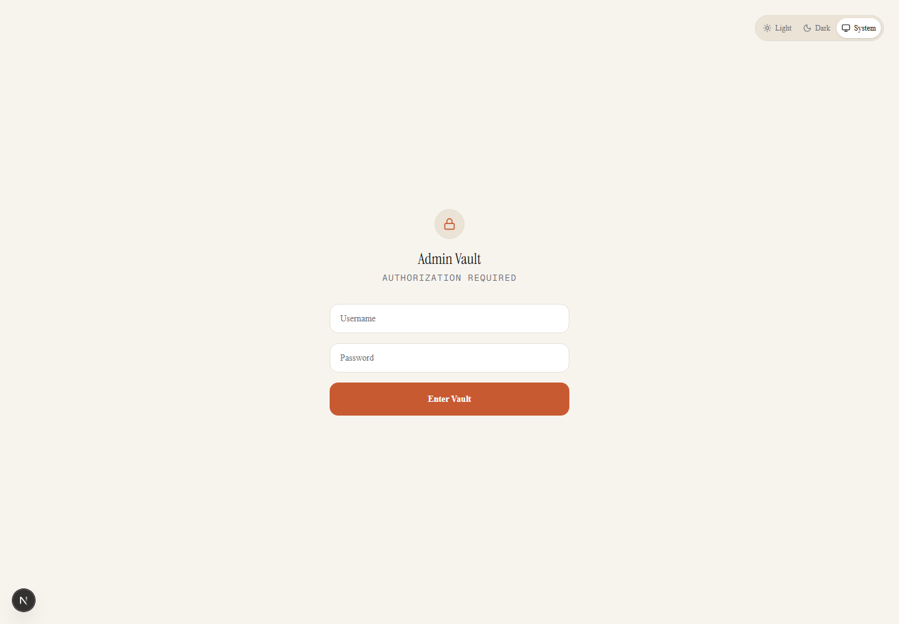
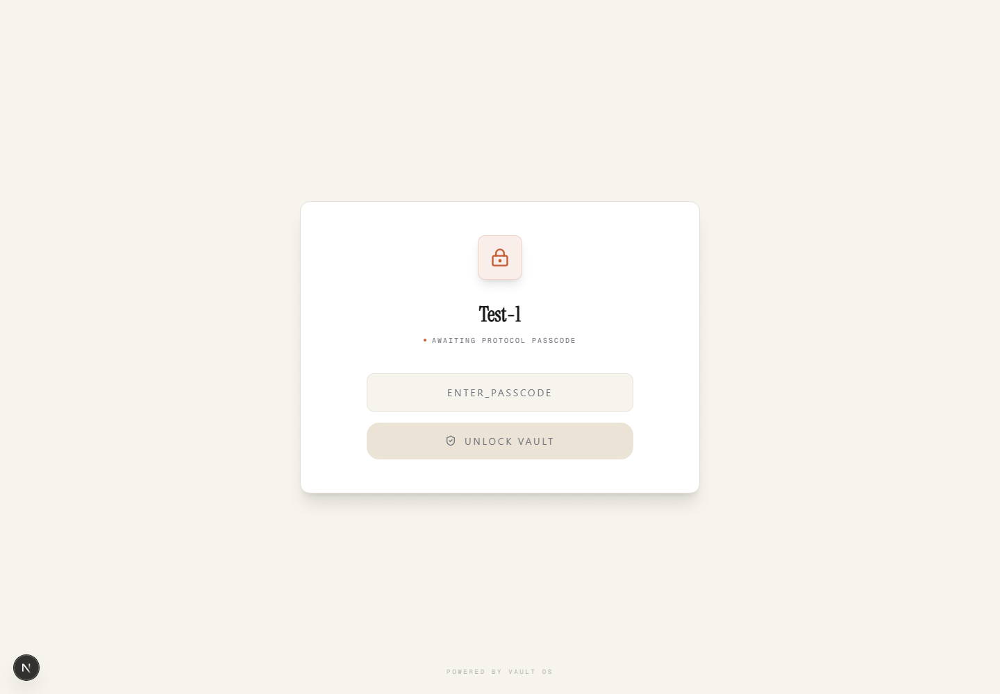

# Vault OS Documentation

This documentation describes the implementation currently in the repository.

## Guides

| Guide | Purpose |
| --- | --- |
| [Architecture](architecture.md) | Components, data model, authorization, and end-to-end flows |
| [API reference](api.md) | App Router endpoints, access rules, and request behavior |
| [Security and privacy](security-privacy.md) | Credentials, cookies, passcodes, media access, biometrics, and deployment cautions |
| [Development and operations](development.md) | Local setup, environment variables, database, AWS prerequisites, and deploy checklist |
| [Testing](testing.md) | Unit, API, browser, and production-build checks; limitations of each |

## Screenshots

The following images were captured from the local development app at a 1440-pixel desktop viewport. The admin view contains a local demo event (`Test-1`); it is illustrative, not production data.

### Admin command center

### Admin login

### Guest passcode gate

## Documentation maintenance

When API behavior changes, update the matching row in [API reference](api.md), the relevant data flow in [Architecture](architecture.md), and a test or limitation in [Testing](testing.md). Keep secrets, live personal data, and real face images out of screenshots and examples.
