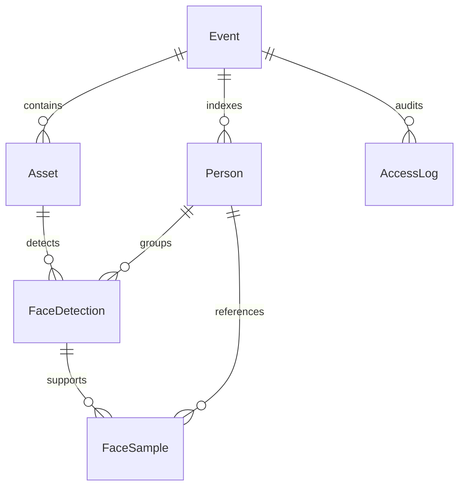
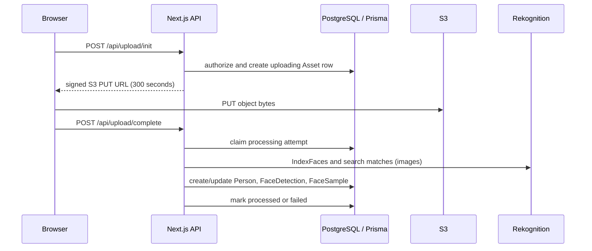

# Architecture

**Status:** describes the current implementation in the repository, reviewed 2026-11-01.

## Product boundary

Vault OS is a Next.js event-media application. An administrator creates event vaults, manages uploads and moderation, and configures guest access. Guests enter an event passcode to browse eligible photos or use a liveness-checked face search to find their own photos.

The application owns the web interface, route authorization, database records, and media orchestration. PostgreSQL stores metadata and biometric references. Amazon S3 stores original media. Amazon Rekognition handles face collections, indexing, matching, and liveness sessions.

## Runtime components

| Concern | Implementation |
| --- | --- |
| Web application | Next.js 16 App Router, React 19, TypeScript |
| Admin authentication | NextAuth credentials provider; `ADMIN_USERNAME` and `ADMIN_PASSWORD` |
| Guest authentication | Event passcode verified against an encrypted or legacy stored passcode; signed event-scoped HTTP-only cookies |
| Persistence | PostgreSQL through Prisma (`lib/prisma.ts`) |
| Media storage | Private S3 objects; direct browser upload using short-lived signed PUT URLs; private server proxy for reads |
| Face processing | AWS Rekognition collections and face APIs, orchestrated by route handlers |
| Image processing | `sharp` for orientation, resizing, and format conversion |
| Liveness UI | AWS Amplify `FaceLivenessDetector`, configured with a Cognito Identity Pool |
| Styling | Tailwind CSS v4, semantic CSS tokens, Geist / Geist Mono / Instrument Serif |

## Data model

- **Event**: owner, title, passcode, guest-upload policy, public-gallery and biometric-search switches, optional theme media key.
- **Asset**: event-scoped S3 key, original filename, image/video type, uploader, processing status, moderation status, and AWS job metadata.
- **Person**: event-scoped identity cluster, optional admin-provided name, and workflow status.
- **FaceDetection**: Rekognition face ID, confidence and bounding box; connects one asset to one person.
- **FaceSample**: person-to-detection reference used by the face-matching workflow.
- **AccessLog**: event access, passcode-attempt, admin telemetry, and biometric events.

`Asset.status` and `moderationState` are Prisma `String` columns. The schema defaults use uppercase `PENDING`, while route code uses lowercase values such as `uploading`, `processing`, `processed`, `failed`, `pending`, and `approved`. Treat this as a schema/runtime consistency caveat when provisioning or migrating databases; do not assume a database enum enforces these values.

## Main data flows

### Administrator creates a vault

1. Credentials are checked by NextAuth and the session receives the stable admin ID `admin-001`.
2. The event route validates a title and passcode, encrypts the passcode, and stores the event with its owner ID.
3. The server attempts to initialize a Rekognition collection named `event-{eventId}`. Collection setup failure is logged; the event creation response can still succeed.
4. Admin event and asset routes authorize the session against `ownerId` (including the legacy owner ID mapping in `lib/auth.ts`).

### Media upload and processing

Upload initialization accepts a single file or a batch of up to 100. Each file must be positive-sized, match its declared `image` or `video` type, and be no larger than 50 MiB. Guest uploads require an allowed event policy and a verified person identity. Guest media starts in pending moderation; owner uploads are approved by default. `upload/complete` indexes images, but video files are not face-indexed.

For WebP, the completion handler downloads the object and converts it to JPEG bytes before calling Rekognition. Other image types are passed by S3 object reference.

Face matching limits concurrent `SearchFaces` calls to two per Node.js process and retries AWS throughput/throttling exceptions up to three times with exponential backoff and jitter. This reduces bursts but is process-local; multi-instance deployments should monitor Rekognition quotas and consider a durable queue or quota increase for sustained upload volume.

### Guest access and face search

1. A guest submits an event passcode through a page action or verification route.
2. Verification is rate-limited and records failed attempts. A successful check issues a signed, event-scoped cookie; the face-search flow can issue an additional person-scoped cookie.
3. Public-gallery access is constrained to approved, processed media. In non-public galleries, personal media access is checked against the guest's verified identity and face detections.
4. For “Find Me,” the browser obtains an AWS liveness session, completes capture with Amplify, then posts the session ID to the server. The server checks liveness, searches the event Rekognition collection, resolves a database identity, and returns that person's approved, processed photos.

### Media reads and downloads

The browser does not receive a public S3 object URL for gallery media. `/api/upload/view` authorizes the caller, fetches the private object server-side, applies optional image transformations, and returns private, non-cacheable bytes. Explicit authorization failures return `403`; unexpected S3/image-processing failures are logged and return `502` instead of being mislabeled as access denials. Download URL requests are also authorized before a short-lived URL is signed. ZIP endpoints stream S3 object bodies through `archiver` rather than buffering the whole archive to disk.

## Trust boundaries

- Browser credentials and the Cognito unauthenticated identity are distinct from server-side AWS credentials.
- NextAuth protects admin pages, but API routes also perform authorization; a page-level middleware check is not a substitute for route checks.
- Guest cookies are event-scoped and signed with `NEXTAUTH_SECRET`; person cookies are separately scoped to a person and event.
- S3 is expected to be private. Application-level access checks are required before signing or proxying media.
- Rekognition face IDs and liveness results are sensitive biometric data. See [Security and privacy](security-privacy.md).
